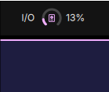
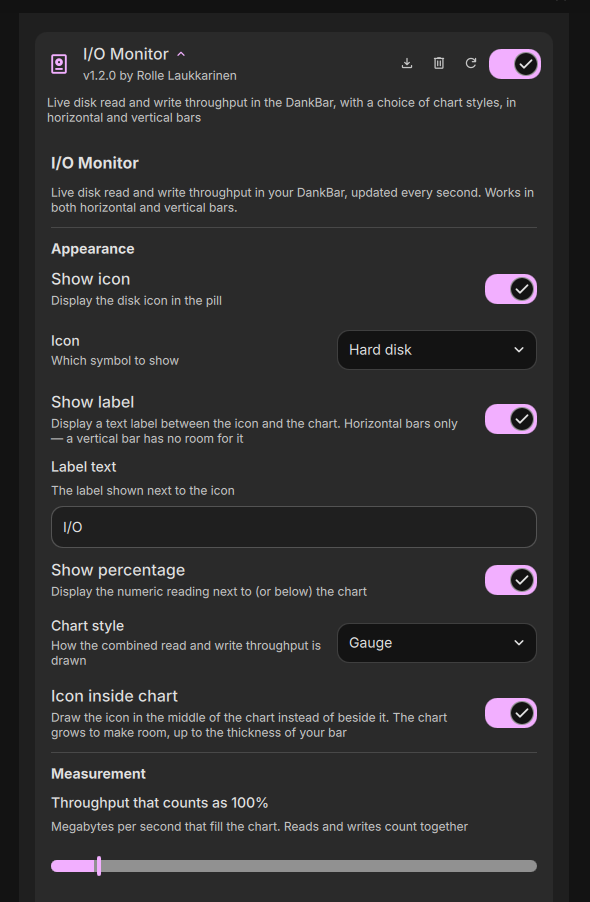

# I/O Monitor

Live disk read and write throughput in your [DankBar](https://github.com/AvengeMedia/DankMaterialShell), updated every second. Sibling of [RAM Monitor](https://github.com/rollecode/dms-ram-monitor), [VRAM Monitor](https://github.com/rollecode/dms-vram-monitor), [GPU Monitor](https://github.com/rollecode/dms-gpu-monitor), [CPU Monitor](https://github.com/rollecode/dms-cpu-monitor) and [Disk Monitor](https://github.com/rollecode/dms-disk-monitor).


## What it does

- Compact bar pill: icon, optional label, animated chart and percentage, sized by the bar's own font scale
- Horizontal and vertical bars. A vertical bar stacks the icon, chart and percentage and drops the label, which never fits in a bar only as wide as one icon
- Five chart styles — horizontal bar, vertical bar, gauge, donut, pie — or none, for a text-only pill
- Reads and writes counted together against a configurable full-scale throughput
- Fill follows your theme accent, turns orange above 75% and red above 90%
- Click the pill for the breakdown: read, write and the busiest disk pinned on top, then each disk, then per-process I/O with a kill icon on each row
- Zero dependencies



## The popout

System totals come from `/proc/vmstat`, so they work on every machine, including ones whose udev rules disable per-device I/O accounting. Per-disk rows appear when the kernel is keeping those counters. Rates need two samples, so everything is measured across one short window. Per-process figures come from `/proc/<pid>/io`, which counts real block-device traffic rather than page-cache hits; processes owned by other users are unreadable without privileges and are skipped.

Each process shows a second, dimmer word where one can be resolved: the script for interpreters, the working directory for shells, the subprocess type for Electron apps.

## Installation

From the DMS plugin browser (Settings, Plugins, Browse), or manually:

```bash
git clone https://github.com/rollecode/dms-io-monitor ~/.config/DankMaterialShell/plugins/ioMonitor
```

Then enable it in Settings, Plugins, and add the widget to your bar layout in Settings, Bar.

## Settings

- **Show icon**: toggle the symbol at the start of the pill (on by default)
- **Icon**: hard disk, hard drive, platter, storage, database, save, read/write arrows, transfer arrows, or any Material Symbols name you type in (default `hard_disk`)
- **Icon inside chart**: for the gauge, donut and pie, draw the icon in the middle of the chart rather than beside it (on by default). The chart grows to make room, up to the thickness of your bar
- **Show label**: toggle the text label between the icon and the chart (on by default). Horizontal bars only
- **Label text**: customize the label (default `I/O`)
- **Show percentage**: toggle the numeric reading (on by default)
- **Chart style**: horizontal bar, vertical bar, gauge, donut, pie or none (default horizontal bar)
- **Bar height / width**: how thick the bar chart is drawn, as a share of the space it is given (default 35%)
- **Throughput that counts as 100%**: megabytes per second that fill the chart, reads and writes together (default 200)
- **Entries to show**: how many rows the popout lists, 5 to 60 (default 30)



## License

MIT
